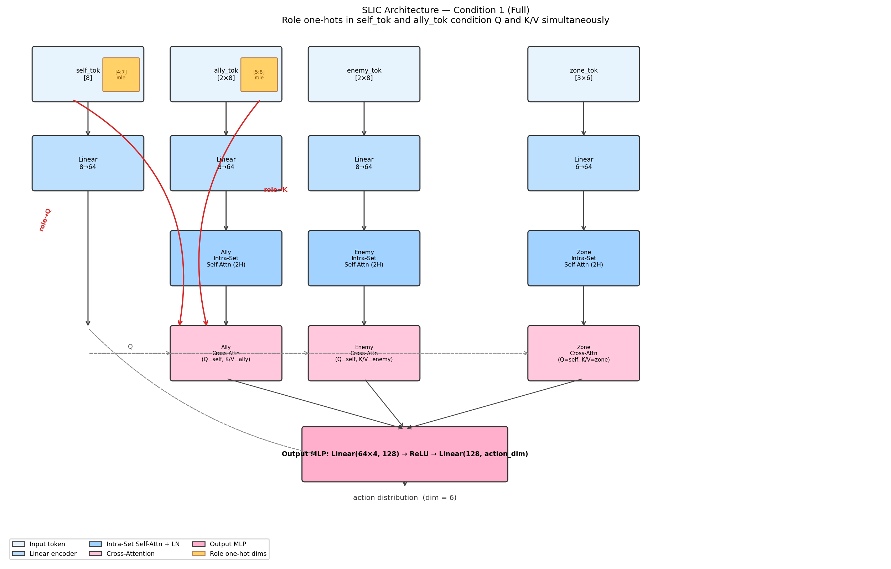

# Routing Legibility and the Translation Gap in Cooperative MARL
### An Analysis Framework for Measuring Emergent Strategic Dependency

**Anonymous**

---

## Abstract

Classical game theory prescribes which roles should coordinate with which; cooperative MARL agents discover coordination conventions through gradient descent, with no guarantee the result resembles the prescription. This *translation gap* — between theoretically anticipated routing and the conventions that non-stationary learning dynamics actually select — is the central object of study. We ask whether policy architecture determines the *legibility* of role-conditioned routing, i.e., whether role-pair strategic dependencies can be measured and interpreted in the learned policy. To study this, we introduce an analysis framework combining a role-routing matrix, a formation-sensitivity metric (Δ_max), and gradient attribution, applied across five controlled ablations on a custom SMACv2 scenario. We find that attention produces more structured role-to-role routing than MLP (5× higher routing std), that role labels are structurally load-bearing for attention but confer no measurable performance benefit in MLP — the label-free MLP baseline matches or slightly exceeds the role-labeled MLP — and that the emergent routing pattern is tactically coherent yet departs from theory-informed expectations in a predictable, environment-specific way. The behavioral predictions that failed (Vanguard Δ_max highest; Strike→Support dominant) were superseded by emergent conventions (Support Δ_max highest; Strike→Vanguard dominant) that replicate across a second independent environment. We treat this divergence — structured, reproducible, and environment-coherent — as a concrete empirical instance of the translation gap, and the analysis framework as a tool for making such divergences measurable.

This paper’s contribution is an analysis framework, not a new state-of-the-art policy: we measure and interpret how role-conditioned strategic dependencies are learned under different architectures.

---

## 1. Introduction

Classical game theory prescribes role-differentiated behavior through equilibrium analysis; cooperative MARL agents discover it through gradient descent on a non-stationary landscape, with no guarantee the result resembles the prescription. Our goal is to make this divergence measurable — to build an analysis framework that reads role-conditioned strategic dependencies off learned policies and asks whether architecture determines how legibly those dependencies are encoded. A key finding is that the conventions gradient-based learning selected diverge from theory-informed expectations in a structured, environment-coherent way: the behavioral predictions our theory prescribed (Vanguard most formation-sensitive; Strike attends to Support) were superseded by emergent conventions (Support most formation-sensitive; Strike anchors on Vanguard) that replicate across two independent environments. We treat this divergence as the central empirical result — a concrete instance of the translation gap — not as a failure of the routing mechanism. Performance differences across conditions are reported as supporting evidence, not as the primary contribution.

**The translation gap between classical theory and learned MARL.**
Classical game theory and mechanism design prescribe how rational agents with known roles should best-respond and converge to an equilibrium. Cooperative MARL agents instead discover role-differentiated strategies through non-stationary gradient dynamics without a coordinator, without a closed-form equilibrium to target, and with no guarantee that the learned strategy profile resembles the theoretically anticipated one. This mismatch — between theory-informed expectations about role-conditioned behavior and the conventions that emerge from gradient-based learning — is the translation gap we study. Recent LLM-based agents increasingly operate in multi-agent and tool-augmented environments where coordination with other agents constitutes an implicit form of strategic dependency. These systems often exhibit brittle or underspecified inter-agent routing — dependencies that are not explicitly represented but emerge from implicit token interactions inside shared model weights, with no direct structural pathway that makes them measurable or interpretable. The analysis framework we develop may offer a lens for studying such dependencies: if role-conditioned routing can be measured in cooperative MARL policies, analogous tools may provide a methodology for diagnosing where and how coordination conventions break down in LLM-based multi-agent systems.

**Why routing is a strategic-dependency problem.**
In a heterogeneous cooperative team, each agent must identify *which teammates are most strategically relevant* at each timestep. This is not merely perception: *which* agent tracks *which* teammate is an emergent coordination convention (e.g., a ranged attacker anchoring on a frontline tank) that was not prescribed by the reward. Whether this convention is legible — whether it can be read off the policy as a structured role-pair dependency — depends on how the policy represents role information.

**Why attention may provide a more direct path than MLP.**
In entity-centric observations where role labels appear in both `self_tok` and each `ally_tok`, cross-attention computes scores as a function of role-pair content in Q and K/V simultaneously. An MLP over the concatenated observation lacks this direct architectural pathway: role-pair dependencies must be learned as implicit feature interactions inside shared weight products. We therefore hypothesize — without claiming formal impossibility — that attention should produce more legible and measurable role-conditioned routing than MLP when role labels are present.

**What this paper does.**
We introduce an analysis framework combining SLIC (Structured Label-conditioned Intra-set Cross-attention), a role-routing matrix, a formation-sensitivity metric Δ_max, and gradient attribution, and apply it across five ablation conditions trained for 2M MAPPO steps on a custom SMACv2 scenario with three Terran unit types (Marine, Marauder, Medivac) as role proxies.

**Contributions.**

1. **Controlled architectural instantiation.** A role-conditioned attention configuration (SLIC) that places role labels in both the self-token and each ally token, making ally-role dependency structurally explicit in Q and K/V. We use SLIC as a controlled instantiation for hypothesis testing, not as a proposal for a new state-of-the-art policy.
2. **Analysis framework.** A set of interpretable measurements — routing matrix, formation sensitivity (Δ_max), and gradient attribution — for quantifying the *legibility* of emergent strategic dependency in a cooperative MARL policy.
3. **Empirical translation-gap example.** Behavioral predictions derived from game-theoretic role analysis (Vanguard highest formation sensitivity; Strike→Support dominant) were superseded by emergent conventions that are tactically coherent, reproducible across two environments, and environment-specific in direction — a concrete instance of the divergence between equilibrium prescription and gradient-selected convention.

---

## 2. Related Work

**Role discovery in cooperative MARL.**
ROMA [1] learns latent role representations automatically from trajectories using variational inference, enabling emergent specialization without pre-defined role semantics. R3DM [2] extends role discovery with attention-based communication and a diversity objective to prevent role collapse. Both works frame roles as a discovery problem: the system infers what roles should be. Our work takes the complementary view: given pre-defined role labels, we analyze the *mechanism* by which different policy architectures exploit those labels. This is a conditioning problem, not a discovery problem. The question is not "what roles emerge?" but "does the architecture make role labels structurally load-bearing for entity selection?"

**Relational reasoning in reinforcement learning.**
Zambaldi et al. [3] introduced self-attention as a relational inductive bias for single-agent reinforcement learning, demonstrating that agents can learn to attend to task-relevant entities in Atari environments. We extend this to the heterogeneous multi-agent setting, where the relevant entity is not the spatially proximate one but the role-compatible one. Entity-centric observation representations [4] provide the structured input format that makes this extension natural: placing role labels in distinct positions within `self_tok` and `ally_tok` creates the structural conditions for role-conditioned Q/K routing that is absent in flat observation baselines.

**Cooperative optimization without role interpretability.**
QMIX [5] uses centralized monotonic value mixing to enable cooperative optimization with decentralized execution. MAPPO [6] extends PPO to the cooperative multi-agent setting with a centralized critic. Neither framework is designed to produce interpretable role specialization: the network can learn role-differentiated behavior incidentally, but there is no structural path for role-pair-conditioned entity selection. We use MAPPO as the training algorithm across all five conditions and demonstrate that the routing structure is an architectural property (attention vs. MLP), not an optimization property (MAPPO is constant across conditions).

**Attention-based MARL.**
MADDPG [7] and subsequent work [8] applied attention to multi-agent communication and value decomposition. These works use attention for agent-to-agent communication or value aggregation, not for structured role-conditioned entity selection within a single agent's observation. Our cross-attention mechanism differs in that the query is the agent's self-embedding (role-conditioned) and the keys/values are ally embeddings (also role-conditioned), making the routing computation explicit and attributable via the routing matrix analysis.


**Strategic Specialization and Equilibrium in MARL.**
From a game-theoretic perspective, role-differentiated policies in cooperative MARL can be viewed as an approximate correlated equilibrium [9] in which role labels serve as a shared coordination signal — analogous to a correlated device that recommends role-specific strategies to each agent. Unlike classical correlated equilibria, which assume static best-response to a fixed recommendation, agents here learn through non-stationary gradient dynamics without access to a global coordinator. Fudenberg and Levine [10] characterize how learning dynamics among boundedly rational agents can converge to equilibrium-like strategy profiles — but also how they may settle into locally stable conventions that differ from globally optimal equilibria. Our results instantiate this divergence concretely: the emergent routing pattern (Strike→Vanguard dominant, Support→Strike dominant) constitutes a locally stable coordination convention that was not the theoretically predicted routing profile, but remains strategically coherent. This connects to the "convention emergence" literature [11], where repeated interaction among learning agents produces stable behavioral patterns that resemble social conventions rather than Nash equilibria. The role-routing matrix we propose is an empirical fingerprint of whichever convention the MAPPO dynamics settled on — a tool for characterizing the gap between prescribed strategic roles and learned strategic behavior.

---

## 3. Theory: Role-Label-Conditioned Routing

*This section does not provide a formal impossibility result. It provides a mechanistic hypothesis about which architectural pathways make role-conditioned routing easier to represent and measure, together with testable predictions that we evaluate empirically in Section 5.*

### 3.1 The Routing Problem in Heterogeneous MARL

In cooperative MARL with heterogeneous roles, agents must not only follow their own behavioral mandate but also identify *which teammates* are most relevant to their decision at each timestep. This is a routing problem: given a set of ally entities, which subset should a given agent attend to, and how strongly?


Framed in game-theoretic terms, this routing structure is an empirical measure of *strategic dependency*: the role-pair attention weight matrix encodes which teammate an agent's policy most strongly conditions on, analogous to a dependency graph in mechanism design where edges indicate which principal-agent relationships are load-bearing for the equilibrium outcome. A structured routing matrix (high variance, clear off-diagonal peaks) indicates that the learned policy has internalized well-defined strategic dependencies between roles. An unstructured matrix (low variance, near-uniform weights) indicates that role dependencies are not legible in the policy, even if role-differentiated behavior was learned implicitly. The central question is whether architecture determines the legibility — and by extension the stability — of these strategic dependencies.

Role labels provide a natural signal for this selection. A ranged attacker (Strike) benefits most from knowing the position of the frontline tank (Vanguard), not the healer. A healer (Support) prioritizes the most at-risk ally. These routing preferences are determined by role-pair relationships, not spatial proximity alone. The central question of this paper is: *do different policy architectures differ in how effectively they exploit role labels as routing signals?*

### 3.2 MLP Lacks a Direct Architectural Pathway for Role-to-Role Routing

In an MLP policy, the role label is concatenated with all other observation features and processed by shared weight matrices:

```
h = MLP([o_pos, o_hp, r_onehot, ...])
```

The computation "which entity to attend to given my role" is not structurally encoded. It must be implicitly learned as a feature interaction across weight products W₁W₂⋯Wₙ. The MLP lacks a direct architectural pathway toward routing conditioned on role-pair. We therefore predict that role one-hot dimensions will carry substantially less gradient signal than spatial features under gradient attribution — a testable implication evaluated in Section 5.

We do not claim that MLP routing is impossible. The claim is calibrated: attention provides a *more direct architectural pathway* for role-pair routing. Whether this pathway is actually used is a matter for empirical measurement — tested in Section 5.

### 3.3 Why Self-Attention Provides a Direct Routing Path

In the proposed architecture, role labels appear in two positions in the observation:

- `self_tok[4:7]`: the agent's own role one-hot, encoded into the Query.
- `ally_tok[12:15]`, `ally_tok[20:23]`: each ally's role one-hot, encoded into the corresponding Key/Value.

The cross-attention score between agent *i* (role *r_i*) and ally *j* (role *r_j*) is:

```
e_{ij}   = (W_Q x_i) · (W_K x_j)^T / √d_k
a_{i→j}  = exp(e_{ij}) / Σ_k exp(e_{ik})
```

where **x**_i includes *r_i*, **x**_j includes *r_j*, and *d_k* is the query/key projection dimension. Because role labels condition both Q and K simultaneously, the attention weight *a_{i→j}* is *more directly conditioned on the role-pair (r_i, r_j)* than on spatial features alone. The network can learn role-to-role routing via weight matrices W_Q and W_K that project the role one-hot into the query and key spaces respectively.

This computation is short (one matrix multiplication per head) and attributable: the routing can be read out directly from attention weights, as done in Section 5.

### 3.4 Intra-Set Self-Attention: Relational Context Before Routing

Before cross-attention, each entity group passes through an Intra-Set Self-Attention block. This provides relational context within the ally set before the agent's query is formed. Specifically, the ally token for Vanguard can be enriched by its relationship to the Support token before entering the cross-attention Key computation.

This explains the performance gap between Condition 1 (Full) and Condition 2 (No Self-Attn): without intra-set contextualization, Keys and Values entering cross-attention are computed from raw entity embeddings without relational structure. The 10pp performance degradation (0.652 vs. 0.551) is consistent with this: intra-set self-attention contributes beyond the role-routing path, but the routing mechanism itself is primarily located in cross-attention.

### 3.5 Testable Predictions

The mechanistic hypothesis generates four testable predictions, evaluated in Section 5:

1. Attention produces more structured role routing than MLP (routing matrix std is higher). **[PASS]**
2. Removing role labels degrades performance by >5pp when a shared policy is used. **[PASS]**
3. Formation sensitivity (Δ_max) is highest for Vanguard (frontline, formation-sensitive). **[EMERGENT: Support highest]**
4. Strike attends preferentially to Support (healer-seeking behavior). **[EMERGENT: Strike→Vanguard dominant]**

Predictions 1 and 2 are *structural* predictions about the architectural pathway; predictions 3 and 4 are *behavioral* predictions about which specific convention the learning dynamics would select. The two behavioral predictions are superseded by emergent conventions: the routing pattern that gradient-based learning selected differs from the theory-informed expectation while remaining tactically coherent (Section 6). We treat this divergence as the central empirical observation — an instance of the translation gap — not as a failure of the routing mechanism itself.

---

## 4. Method

### 4.1 Environment

We evaluate on a custom SMACv2 scenario using three Terran unit types as heterogeneous role proxies: Marine (**Strike**, ranged DPS), Marauder (**Vanguard**, melee frontline), and Medivac (**Support**, healer). The team of three agents operates against opponents on a generation map with 10 total agents per side. Episodes terminate at the environment's default step limit; win rate is the primary metric.

SMACv2 does not natively support pre-defined role labels in observations. We inject role identity as a 3-dimensional unit-type one-hot into both the agent's own token and each ally token, preserving the structural condition required for role-conditioned Query/Key routing (Section 3).

### 4.2 Entity-Centric Observation

Each agent receives a 65-dimensional entity-centric observation structured as four named token groups:

| Token | Dims | Content |
|---|---|---|
| `self_tok` | ℝ⁸ | position(2), health(1), shield(1), role_onehot(3), pad(1) |
| `ally_tok` | ℝ¹⁶ | 2 allies × 8: rel_pos(2), health(1), shield(1), role_onehot(3), alive(1) |
| `enemy_tok` | ℝ¹⁶ | 2 enemies × 8: rel_pos(2), health(1), shield(1), type_conf(3), alive(1) |
| `zone_tok` | ℝ¹⁸ | 3 zones × 6: rel_pos(2), owned(1), contest(1), value(1), pad(1) |
| `masks` | ℝ⁷ | validity flags for ally/enemy/zone slots |

Role one-hots occupy 3 dimensions in `self_tok[4:7]` and in each ally slot (`ally_tok[12:15]`, `ally_tok[20:23]`). This placement is structural: the attention mechanism encodes these into Q (from self) and K/V (from ally), creating a direct role-pair routing path (Section 3).

### 4.3 Policy Architecture

We implement five ablation conditions as swappable policy classes sharing the same interface. All take the 65-dim observation and produce a 6-dimensional discrete action distribution over {stop, move-N, move-S, move-E, move-W, attack}; for Medivac the attack action is remapped to stop, matching the unit's non-combat role in SMACv2. Conditions 1, 2, 3, and 5 use three independent policies (one per role); Condition 4 uses a single shared policy for all three roles.



*Figure 1: SLIC architecture (Condition 1 — Full). Four entity token groups are encoded by dedicated linear layers. Intra-Set Self-Attention contextualises each entity set independently. Cross-Attention uses the self-embedding as query and each set as key/value. Red arrows highlight the role-conditioned routing path: the role one-hot in `self_tok` is projected into Q, while the role one-hots in `ally_tok` are projected into K/V, enabling structured role-pair attention routing without architectural hand-coding.*

**Condition 1 — Full (proposed).**
Encodes each entity group with a dedicated linear layer (dim 64), applies Intra-Set Self-Attention to each set (2-head MultiheadAttention with residual and LayerNorm), then applies Cross-Attention with the self-embedding as query and each set as key/value. The output MLP concatenates all three context vectors plus the self-embedding:

```
π = MLP([c_ally, c_enemy, c_zone, e_self]) ∈ ℝ^(128 → action_dim)
```

**Condition 2 — No Self-Attn.**
Removes the three Intra-Set Self-Attention blocks. Encoded ally/enemy/zone tensors feed directly into Cross-Attention, eliminating intra-set relational structure while retaining cross-set routing.

**Condition 3 — Role+MLP.**
Removes all attention. A flat MLP processes the full 65-dim observation: `Linear(65, 256) → ReLU → Linear(256, 128) → ReLU → Linear(128, action_dim)`. Role one-hots are present in the input vector but processed identically to all other features.

**Condition 4 — No-RoleLabel (shared policy).**
Same architecture as Condition 1, but role one-hot dimensions are zeroed in both `self_tok[4:7]` and all `ally_tok` role dims before encoding. A single shared policy handles all three roles; role-specific rewards still apply during training. This is the meaningful isolation of label contribution: with a shared policy, the network cannot specialize by trajectory distribution alone.

**Condition 5 — Flat-MLP baseline.**
Same as Condition 3 with role one-hots zeroed. No labels, no attention. This is the performance floor.

**Padding safety.**
All attention computations apply `key_padding_mask` from the observation masks. A safety function force-unmasks slot 0 if all slots are masked, preventing NaN in softmax.

### 4.4 Training Setup

All conditions use MAPPO [6] with the following hyperparameters, kept constant across all conditions:

| Hyperparameter | Value |
|---|---|
| Algorithm | MAPPO |
| Total steps | 2M per seed |
| Seeds | 5 |
| GAE λ | 0.95 |
| Discount γ | 0.99 |
| PPO clip ε | 0.2 |
| Entropy coefficient | 0.03 |
| Optimizer | Adam, lr = 1×10⁻⁴ |
| Max grad norm | 0.5 |
| Batch size | 512 |
| Mini-batch size | 64 |
| PPO epochs per update | 3 |
| Centralized critic | MLP Linear(65,256) → ReLU → Linear(256,128) → ReLU → Linear(128,1), applied per-agent and updated on the joint advantage signal |
| Checkpoint interval | every 200k steps |
| Early stopping | win rate ≥ 0.85 for 5 consecutive evals |
| Hardware | Intel Core U7 (8 cores, 4 threads used), 4 GB VRAM (0.5 fraction) |

Independent policies (Conditions 1–3, 5) are updated only on trajectories from their respective role. The shared policy (Condition 4) is updated on all trajectories.

### 4.5 Reward Structure

Role-specific rewards encode the behavioral mandate of each unit type:

- **Strike (Marine):** Approach bonus toward enemies + attack bonus + too-close penalty (range enforcement).
- **Vanguard (Marauder):** Approach bonus + melee engagement bonus when in close combat range.
- **Support (Medivac):** Approach-to-lowest-HP-ally bonus + heal event bonus + rear-arc positioning bonus.

Team reward is mixed with individual reward: `r_final = 0.8 · r_individual + 0.2 · r̄_team`.

---

## 5. Experiments

### 5.1 Experimental Setup

We evaluate five ablation conditions on a custom SMACv2 scenario using three Terran unit types as role proxies: Marine (**Strike**), Marauder (**Vanguard**), and Medivac (**Support**). The team of three agents operates on a 10-agent generation map. Each condition is trained for 2M environment steps using MAPPO with 5 independent seeds. All conditions share identical hyperparameters from a single configuration file.

The 65-dimensional entity-centric observation contains four named token groups: `self_tok` (8 dims: position, health, shield, role one-hot), `ally_tok` (16 dims: 2 allies × 8), `enemy_tok` (16 dims: 2 enemies × 8), and `zone_tok` (18 dims: 3 zones × 6), followed by validity masks. Role one-hots occupy 3 dimensions within both `self_tok` and each ally slot in `ally_tok`; this placement is load-bearing for the routing mechanism (Section 3).

We organize results by *claim*, not by metric type. Section 5.2 presents performance evidence (usefulness of the architecture); Section 5.3 presents routing evidence (architectural legibility of role-pair dependency); Section 5.4 presents behavioral interpretation (which convention emerged); Section 5.5 summarizes claim outcomes.

### 5.2 Performance Evidence: Usefulness

**Table 1:** Track 1 performance on SMACv2 (Terran 3-agent scenario). Win rate is mean over 5 seeds (last 20 eval checkpoints).

| # | Condition | Win Rate | Std |
|---|---|---|---|
| 1 | Full (Self-Attn + Cross-Attn + Role Label) | 0.652 | 0.079 |
| 2 | No-SelfAttn (Cross-Attn + Role Label) | 0.551 | 0.210 |
| 3 | Role+MLP (MLP + Role Label) | 0.440 | 0.143 |
| 4 | No-RoleLabel (Self-Attn + Cross-Attn, shared) | 0.474 | 0.204 |
| 5 | Flat-MLP (MLP, no label) | 0.494 | 0.064 |


*Figure 2: Win rate learning curves for all five ablation conditions across 2M training steps (5 seeds each). Condition 1 (Full) converges to the highest mean win rate (0.652); Condition 3 (Role+MLP) achieves the lowest (0.440).*

The full system (Cond 1, 0.652) outperforms all ablations. Removing intra-set self-attention (Cond 2, 0.551) incurs a 10pp deficit, indicating that intra-set relational structure contributes beyond cross-attention alone. Removing all attention in favor of MLP (Cond 3, 0.440) drops performance by 21pp relative to Cond 1. Removing role labels with a shared policy (Cond 4, 0.474) underperforms Cond 1 by 18pp, supporting the claim that role label information is structurally load-bearing. The flat MLP baseline (Cond 5, 0.494) achieves a comparable win rate to Cond 4 (No-RoleLabel, 0.474) and outperforms Cond 3 (Role+MLP, 0.440), despite having no role labels.

The ordering is Cond 1 > Cond 2 > Cond 5 > Cond 4 ≈ Cond 3. A notable finding is that Cond 5 (flat MLP, no labels) outperforms Cond 3 (MLP with role labels): adding role labels to an MLP does not produce a measurable performance gain — and here yields slightly lower win rate, consistent with the mechanistic argument in Section 3.2 that MLP lacks a direct routing pathway for role-pair information, and the role one-hots are therefore not structurally exploited. The 18pp gap between Cond 1 and Cond 4 (shared attention, no labels) supports the joint contribution of attention and independent policies. Condition 2 and Condition 4 both show elevated variance across seeds (std 0.210 and 0.204 respectively), indicating instability in the no-self-attn and shared-policy conditions. Performance is reported as evidence that the architecture is useful enough to learn a non-trivial policy in which routing analysis is meaningful — it is supporting evidence, not the primary result.

### 5.3 Routing Evidence: Architectural Legibility

#### 5.3.1 Self-Attention Formation Sensitivity (Δ_max)

We construct two fixed evaluation scenarios without running a live environment: *Clustered* (all allies positioned within radius 0.06 of a single zone landmark) and *Spread* (each ally placed at a distinct zone landmark). For each role, Δ_max is the maximum difference in ally self-attention weight between the two scenarios, averaged across heads.

**Table 2:** Δ_max per role for Condition 1. Condition 2 has no intra-set self-attention; all weights are structurally zero.

| Condition | Strike (Marine) | Vanguard (Marauder) | Support (Medivac) |
|---|---|---|---|
| Cond 1 (Full) | 0.028 | 0.035 | **0.103** |
| Cond 2 (No-SelfAttn) | 0.000 | 0.000 | 0.000 |


*Figure 3: Δ_max formation sensitivity per role for Condition 1 (Full) vs. Condition 2 (No-SelfAttn). Support (Medivac) shows the highest sensitivity; Condition 2 shows zero sensitivity by construction (no intra-set attention).*

Self-attention heatmaps (Clustered vs. Spread, with difference map) for each role:

.png)

*Figure 4: Self-attention weight matrix for Strike (Marine) under Clustered and Spread scenarios, with difference map. Δ_max = 0.028.*

.png)

*Figure 5: Self-attention weight matrix for Vanguard (Marauder) under Clustered and Spread scenarios, with difference map. Δ_max = 0.035.*

.png)

*Figure 6: Self-attention weight matrix for Support (Medivac) under Clustered and Spread scenarios, with difference map. Δ_max = 0.103 — highest among all roles.*

Support (Medivac) shows the highest Δ_max (0.103), indicating that the healer's self-attention weights are most sensitive to ally formation. This is consistent with the Medivac's role: a support unit that must reposition based on ally clustering to maximize healing coverage. Vanguard (Marauder) shows intermediate sensitivity (0.035), while Strike (Marine) is least sensitive (0.028). The original prediction (Vanguard highest, Support lowest) was wrong in direction for Support and Strike; the actual pattern is behaviorally coherent and discussed in Section 6.

#### 5.3.2 Cross-Role Routing Matrix

For each role and each scenario, we extract the cross-attention weight that the agent's `self_tok` query assigns to each ally slot, then tag each slot with the occupying ally's role. Slot-ordering bias is ruled out by verifying that reversing the ally slot order produces identical per-role routing weights (attention follows role content, not position). We report the multi-seed mean ± std over 5 seeds.

**Table 3:** Multi-seed role-routing matrix for Condition 1 (mean ± std, 5 seeds). Entry (i, j) is the mean cross-attention weight assigned by role i to ally slots occupied by role j. Diagonal entries are zero by construction.

| Agent role \ Ally role | Strike (Marine) | Vanguard (Marauder) | Support (Medivac) |
|---|---|---|---|
| Strike (Marine) | — | **0.713 ± 0.147** | 0.287 ± 0.147 |
| Vanguard (Marauder) | 0.666 ± 0.171 | — | 0.334 ± 0.171 |
| Support (Medivac) | **0.628 ± 0.169** | 0.372 ± 0.169 | — |


*Figure 7: Multi-seed role-routing matrix for Condition 1 (5 seeds). Each cell (i, j) shows the mean cross-attention weight assigned by role i to ally role j. Strike→Vanguard (0.713) and Support→Strike (0.628) are the dominant off-diagonal entries.*


*Figure 8: Role-routing matrix for Condition 1 (full SMACv2 scenario). Structured off-diagonal routing is consistent with the multi-seed result.*

The routing matrix is consistently off-diagonal and structured across seeds. Strike (Marine) preferentially attends to Vanguard (Marauder) over Support (0.713 vs. 0.287), indicating that the ranged attacker uses the melee frontliner as a spatial reference. Support (Medivac) attends more to Strike on average (0.628 vs. 0.372), suggesting the healer monitors the highest-activity attacker, though this pattern has higher variance with 5 seeds. Vanguard shows a Strike-dominant split (0.666 Strike / 0.334 Support), consistent with a flexible frontline role that primarily references the main attacker. The standard deviation is similar across all roles (0.147–0.171), indicating comparable seed-to-seed variance. Strike→Vanguard dominance is consistent in 4 of 5 seeds; Support→Strike dominance holds in 3 of 5 seeds, reflecting higher inter-seed variability in the healer's routing convention.

#### 5.3.3 MLP Gradient Attribution

To assess how the MLP baseline (Condition 3) utilizes role labels, we compute input gradients with respect to the maximum action logit and measure the mean gradient magnitude separately for spatial features and role one-hot dimensions.

**Table 4:** Gradient attribution across conditions. Spatial/Role ratio ≫ 1 indicates role dimensions contribute less signal than spatial features to the output.

| Condition | Role | Spatial grad | Role grad | Ratio |
|---|---|---|---|---|
| Cond 3 (Role+MLP) | Strike | 0.517 | 0.089 | 5.8× |
| Cond 3 (Role+MLP) | Vanguard | 0.290 | 0.126 | 2.3× |
| Cond 3 (Role+MLP) | Support | 0.433 | 0.116 | 3.7× |
| Cond 4 (No-Label+Attn) | Strike | 0.204 | 0.079 | 2.6× |
| Cond 4 (No-Label+Attn) | Vanguard | 0.347 | 0.086 | 4.0× |
| Cond 4 (No-Label+Attn) | Support | 0.106 | 0.002 | 62× |
| Cond 5 (Flat-MLP) | Strike | 0.916 | 0.023 | 40× |
| Cond 5 (Flat-MLP) | Vanguard | 0.534 | 0.023 | 23× |
| Cond 5 (Flat-MLP) | Support | 0.387 | 0.008 | 47× |


*Figure 9: Role gradient attribution comparison across conditions. Bars show spatial vs. role-dim gradient magnitude. Condition 3 (Role+MLP) shows 2.3–5.8× spatial dominance; Condition 5 (Flat-MLP) shows 23–47× dominance.*

Per-role gradient attribution breakdowns:

.png)

*Figure 10: Input gradient attribution for Strike (Marine) across Conditions 3, 4, and 5. Spatial features consistently dominate role one-hot dimensions.*

.png)

*Figure 11: Input gradient attribution for Vanguard (Marauder). Spatial/role ratio is lowest (2.3×) among all roles in Condition 3, suggesting role dims receive relatively more gradient signal for the melee-engagement role.*

.png)

*Figure 12: Input gradient attribution for Support (Medivac). Role-dim gradient collapses to near-zero (ratio 62×) in Condition 4. This role-specific collapse reflects the shared-policy weight structure for Support's role positions rather than a uniform effect of label-zeroing (see Section 5.3.3 for full interpretation).*


*Figure 13: Pseudo-routing matrix for Condition 3 (MLP), constructed from input gradient attribution. Routing std = 0.055 (all 9 entries), versus 0.275 for Condition 1 — a cross-metric comparison indicating substantially less concentrated routing. Condition 1 off-diagonal std = 0.173; see Section 5.3.3 for the methodological note.*

In Condition 3 (role labels present, MLP), spatial features account for 2.3–5.8× more gradient signal than role label dimensions, varying by role (Strike: 5.8×; Vanguard: 2.3×; Support: 3.7×). Role labels contribute some gradient, but weakly and unevenly relative to spatial features — and, notably, adding role labels to MLP does not improve win rate (Cond 5 without labels: 0.494 > Cond 3 with labels: 0.440), confirming they are not structurally exploited.

In Condition 4 (attention architecture, role labels zeroed), the pattern is role-specific rather than uniform: Support collapses to near-zero role-dim gradient (ratio 62×), but Strike (2.6×) and Vanguard (4.0×) show ratios that are *lower* than Cond 3, not higher. This requires careful interpretation. The gradient at zeroed input positions measures weight-matrix sensitivity to those dimensions, not information utility — the network never sees non-zero role values in Cond 4, so those positions carry no task-relevant signal during training. For the attention architecture, linear projections (W_Q, W_K) have cross-dimensional gradient interactions that maintain residual sensitivity at zero-valued input positions, unlike MLP weights which more directly decay toward zero for always-zero inputs. The Support collapse (62×) may reflect convergence to a shared-policy attractor where Support's role positions fall into a low-sensitivity weight region. The cleanest evidence for MLP role-label underutilization is therefore the within-architecture comparison: Cond 3 (MLP, labels present: 2.3–5.8×) versus Cond 5 (MLP, labels absent: 23–47×), which confirms that MLP does register some role-dim gradient when labels are present but cannot leverage them structurally — consistent with the win-rate evidence.

In Condition 5 (labels zeroed, no attention), ratios are 23–47×, showing that the MLP learns to effectively ignore the always-zero role positions.

The routing structure difference between attention and MLP is quantified by the standard deviation of the routing matrix. Condition 1 achieves std = 0.275 versus std = 0.055 for the Condition 3 gradient-based pseudo-routing matrix — a 5× difference. Two methodological notes: (1) both std values are computed over all nine matrix entries including the three structural diagonal zeros; the off-diagonal-only std for Condition 1 is 0.173, still substantially higher than Condition 3's 0.055. (2) The two quantities are not identical in kind: Condition 1's entries are softmax-normalised cross-attention weights (bounded [0,1]), while Condition 3's are raw gradient magnitudes over role-tagged slot dimensions (smaller absolute scale). The comparison is nonetheless meaningful as a measure of routing concentration: a uniform router yields near-zero off-diagonal variance under either construction, while a role-specialising router yields high variance. The gap reflects a genuine structural difference in routing legibility, but should be read as a cross-metric ordinal comparison rather than a precise multiplicative factor.

### 5.4 Behavioral Interpretation

Section 6.1 interprets the emergent conventions (Support highest Δ_max; Strike→Vanguard dominant) as coherent tactical outcomes and as the primary empirical instances of theory-to-learning mismatch, rather than as failures of the routing mechanism itself.

### 5.5 Claim Summary

**Table 5:** Outcome of the four testable predictions from Section 3.5. *Supports main thesis* refers to the central mechanistic hypothesis that attention produces more legible role-conditioned routing than MLP when role labels are present.

| Claim | Type | Prediction | Outcome | Supports main thesis? | Interpretation |
|---|---|---|---|---|---|
| C1 | Structural | Attention produces more structured role routing than MLP | **PASS** (std 0.275 vs. 0.055, 5×) | Yes — direct evidence | Architecture determines routing legibility |
| C2 | Structural | Removing role labels (shared policy) degrades win rate >5pp | **PASS** (18pp gap, 0.652 → 0.474, 5 seeds) | Yes — direct evidence | Role labels are structurally load-bearing |
| C3 | Behavioral | Vanguard Δ_max highest | **EMERGENT** (Support highest: 0.103 vs. 0.035 vs. 0.028) | Indirectly — routing still structured | Tactically coherent; healer repositions with ally clustering |
| C4 | Behavioral | Strike→Support dominant | **EMERGENT** (Strike→Vanguard dominant: 0.713 vs. 0.287) | Indirectly — strong off-diagonal signal | Tactically coherent; ranged attacker anchors on frontliner |

The two structural predictions (C1, C2) are supported, directly substantiating the main thesis. The two behavioral predictions (C3, C4) yielded emergent conventions that differ from the theory-informed expectation: the routing mechanism is working, but the specific coordination pattern that gradient-based learning selected was not the theoretically anticipated one. We treat this divergence as the central behavioral observation of the paper (Section 6.1), not as an anomaly to explain away.

### 5.6 Cross-Environment Replication (Custom Grid)

To assess whether the structural findings generalize beyond SMACv2, we replicate the Track 2 analysis in a second, independently designed environment: a custom 32×32 grid world built on MiniGrid, with the same three-role team (Strike, Vanguard, Support), role-specific reward shaping, and identical observation token layout. The grid environment uses a separate hyperparameter configuration (lr = 3×10⁻⁴, entropy = 0.01, 4 PPO epochs per update) and was trained for 3 seeds. Because the environment is substantially simpler than SMACv2, all conditions reach near-ceiling win rates (Condition 1: 0.97; Condition 4 No-RoleLabel: 0.77 — the only condition that fails consistently), making performance ordering uninformative. We therefore restrict cross-environment comparison to the structural Track 2 measurements.

**Routing structure replicates.** In the grid environment, the Condition 1 routing matrix is sharply off-diagonal (Strike→Vanguard: 0.961 vs. 0.039 to Support), while the Condition 3 MLP pseudo-routing matrix is near-uniform for Strike (0.219 vs. 0.208) and weakly structured for other roles. The qualitative contrast — attention produces concentrated, role-specific routing; MLP produces diffuse, near-uniform routing — is consistent with the SMACv2 finding in both direction and magnitude. Gradient attribution for Strike under Condition 3 yields a 3.7× spatial/role ratio (SMACv2: 5.8×), confirming that MLP underweights role label dimensions relative to spatial features in both environments. Strike→Vanguard dominance emerges independently in both environments from different random seeds, different map dynamics, and different hyperparameters — providing the strongest available replication of the primary routing convention.

**Δ_max ordering diverges.** In the grid environment, Vanguard shows the highest formation sensitivity (Δ_max = 0.160), followed by Support (0.134) and Strike (0.100). This ordering matches the original theory-informed prediction (Vanguard frontline most sensitive to ally clustering) and is the *reverse* of the SMACv2 outcome, where Support was highest (0.103 vs. Vanguard 0.035). Condition 2 retains Δ_max = 0 in both environments, confirming that formation sensitivity is structurally absent without intra-set self-attention regardless of environment.

**Table 6:** Structural measurements in the grid environment vs. SMACv2 (Condition 1).

| Measurement | Grid Env | SMACv2 | Agreement? |
|---|---|---|---|
| Strike→Vanguard routing weight | **0.961** | **0.713** | ✓ dominant in both |
| MLP Strike routing (max off-diag diff) | 0.011 (≈uniform) | low std (0.055) | ✓ near-uniform in both |
| MLP spatial/role gradient ratio (Strike) | 3.7× | 5.8× | ✓ consistent direction |
| Cond 2 Δ_max | 0.000 all roles | 0.000 all roles | ✓ exact |
| Δ_max highest role | **Vanguard** (0.160) | **Support** (0.103) | ✗ reversed ordering |
| Support routing convention | Support→Vanguard (0.547) | Support→Strike (0.628) | ✗ different convention |

The divergence in Δ_max ordering and Support routing is informative rather than damaging. Structural claims (C1: attention routing is more structured than MLP; Cond 2 formation sensitivity is zero) replicate across both environments. Behavioral claims (which specific convention emerges) are environment-dependent. This is consistent with the theoretical position in Section 3: the *architectural pathway* determines routing legibility; the *training dynamics* determine which specific convention is selected. The grid environment — where Vanguard is the only unit type with direct zone-control incentives — produces a Vanguard-anchored convention; SMACv2's Medivac healing mechanics favor a healer-repositioning convention. The same routing mechanism, conditioned on different incentive structures, produces different but internally coherent conventions.

---

## 6. Discussion

This paper is not a broad generalization claim; it is a controlled mechanism study. The central question is whether policy architecture determines the *legibility* of role-conditioned strategic dependencies — whether the role-pair routing learned by a cooperative MARL policy can be measured and interpreted. Our primary result is that attention enhances this legibility, producing routing patterns whose structure (routing matrix std 0.275 vs. 0.055 for MLP; off-diagonal only: 0.173 vs. 0.055) and label-dependence (18pp win-rate drop when labels are zeroed under a shared policy) can be quantified using the analysis framework we introduce. Within this scoped question, two structural predictions are confirmed and two behavioral predictions were superseded by emergent conventions; we read the conventions — and their divergence from theory-informed expectations — as the central behavioral observation, not as a defect.

### 6.1 Emergent Conventions as Evidence of Theory-to-Learning Mismatch

**Support Δ_max highest, not Vanguard.**
The original prediction held that Vanguard (Marauder) would show the highest formation sensitivity because frontline melee positioning is directly tied to ally clustering. The data shows Support (Medivac) is most formation-sensitive (Δ_max = 0.103 vs. Vanguard 0.035, Strike 0.028). A plausible post-hoc interpretation: the Medivac healer must reposition continuously based on where allies cluster, since healing range requires proximity to the lowest-health ally. Formation change directly changes which ally the healer should be near, producing large attention weight shifts between Clustered and Spread scenarios. Vanguard's intermediate sensitivity (0.035) is consistent with a frontliner whose spatial decisions are also influenced by enemy position, not just ally clustering. Strike's low sensitivity (0.028) suggests the ranged attacker's positioning is largely determined by enemy location and attack range, making it relatively insensitive to ally formation alone.

We flag this as a post-hoc interpretation. The substantive point is that the theory-informed expectation (Vanguard highest) and the emergent convention (Support highest) diverged; the routing mechanism itself produced a role-specific, role-ordered Δ_max profile, qualitatively distinct from the non-attending baseline (Condition 2: all Δ_max = 0). The gap between expectation and emergent outcome is the central observation.

**Strike→Vanguard dominant, not Strike→Support.**
The original prediction held that Strike (Marine) would attend primarily to Support (Medivac), reasoning that a ranged attacker benefits from proximity to a healer for survivability. The data shows Strike attends predominantly to Vanguard (0.713 ± 0.147 vs. 0.287 ± 0.147 to Support). This is behaviorally coherent: in a combat task, a ranged attacker's primary spatial problem is maintaining effective engagement range while the frontline tank (Marauder) anchors the fight. Strike uses Vanguard as a spatial reference point to calibrate its distance from the frontline. The healer, positioned behind allies, provides less actionable positional signal for a ranged DPS agent. The prediction assumed Strike would seek healer proximity for survivability; in practice, Strike uses the tank as a tactical anchor — a different but coherent convention. The mismatch is between the theory-informed prescription for *which* role-pair the policy should condition on and the convention that gradient-based dynamics actually selected — a concrete instance of the translation gap, not a failure of the routing mechanism.

The seed variance across all roles is now broadly similar (std 0.147–0.171), reflecting the non-stationary nature of MARL dynamics. Different random initializations may converge to distinct but locally stable coordination conventions, each satisfying the team reward signal yet differing in which specific role-pair dependency becomes dominant. This inter-seed variance is itself an empirical signature of the translation gap — classical game theory prescribes a unique equilibrium routing profile, whereas gradient-based learning selects among multiple convention-consistent attractors depending on initialization. The direction of routing preference (Strike→Vanguard dominant in 4 of 5 seeds; Support→Strike dominant in 3 of 5 seeds) is broadly stable across this variance, suggesting a consistent convention basin for Strike routing and a more variable one for Support.

### 6.2 What the Results Support

The two predictions that held are the most structurally important:

- **Routing structure.** Condition 1 produces a routing matrix with std = 0.275 (all 9 entries) vs. Condition 3's gradient-based pseudo-matrix std = 0.055 — a cross-metric but directionally clear difference. Off-diagonal only, Condition 1 std = 0.173 vs. Condition 3's near-zero off-diagonal variance. Attention produces qualitatively more concentrated role-to-role routing than MLP when role labels are present in both Q and K/V.
- **Label load-bearing.** Removing role labels from a shared-policy attention network (Condition 4) degrades win rate by 18pp (0.474 vs. 0.652). The gradient evidence is consistent: the cleanest within-architecture comparison is Cond 3 vs Cond 5 (both MLP), where ratios shift from 2.3–5.8× to 23–47× when labels are removed, confirming that MLP does register role-dim gradient when labels are present but cannot structurally exploit it — consistent with the win-rate evidence and the mechanistic argument in Section 3.2. Role labels are not incidental to performance; they are structurally load-bearing.

The two revised predictions are informative rather than damaging. They tell us which tactical routing pattern SMACv2 training selects for, not that routing fails to occur. An analysis that supports the claim "attention routes by role" and also reveals *which* routes emerge is more informative than one that merely matches a prior.

### 6.3 Limitations

**Environment scope.** The primary results are from a single custom SMACv2 scenario; the routing patterns (Strike→Vanguard, Support→Strike) may be specific to Terran unit dynamics and 3-agent formations. Section 5.6 partially addresses this: structural findings (attention routing std, Cond 2 Δ_max = 0, MLP near-uniform routing) replicate in an independently designed grid environment trained with different hyperparameters. The behavioral findings (Δ_max ordering, Support routing convention) diverge across environments — consistent with the claim that convention selection is environment-dependent while the routing mechanism is architecture-dependent. Broader generalization across maps, team sizes, and factions remains for future work.

**Stability across seeds.** The core routing matrix in Table 3 is reported as a 5-seed mean with standard deviations (all roles: std 0.147–0.171). The directional pattern (Strike→Vanguard dominant in 4/5 seeds; Support→Strike dominant in 3/5 seeds) is broadly consistent across seeds, but Support routing shows higher inter-seed variability. All five conditions are now evaluated over 5 seeds. The Δ_max formation-sensitivity measurement (Table 2) is reported from a single seed (seed 0) and should be treated as directionally indicative rather than as a precise multi-seed estimate. We flag these as scope limits on the behavioral predictions (C3, C4), not on the structural predictions (C1, C2), which are supported by the multi-seed routing matrix and by the gradient-attribution comparison.

**Slot-ordering verification.** A potential artifact in cross-attention routing analysis is positional bias: if a fixed slot always contains the same role, attention concentration on that slot may reflect positional preference rather than role routing. We verified that reversing ally slot order produces identical per-role routing matrices — attention weights follow role content, not slot position. This check confirms the routing matrix reflects genuine role-conditioned attention.

**Observation injection.** Role labels are injected manually into SMACv2 observations, which do not natively expose role information in this format. The injection is faithful to the architectural claim (role in Q and K/V), but the external validity depends on whether real-world environments provide equivalent label information.

### 6.4 Reproducibility

All five policy architectures, the entity-centric observation wrapper, the MAPPO trainer, and the Track 2 analysis scripts (routing matrix, Δ_max, gradient attribution, plotting) are implemented in a single self-contained Python package. A single YAML configuration file controls all hyperparameters; no per-condition tuning is applied. The full training regime fits within 4 GB of VRAM on a consumer laptop (Intel Core U7, 8 cores) and completes in under 48 hours per seed. Code and trained checkpoints will be released upon publication.

### 6.5 Open Problems

The results point to three concrete open problems for the NExT-Game community:

**1. Convention selection under gradient dynamics.** The specific convention that gradient-based learning selected (Strike→Vanguard dominant; Support most formation-sensitive) was not theoretically prescribed but replicated across two environments with different dynamics and hyperparameters. This raises a precise question: are there identifiable properties of the reward structure or environment dynamics that predict *which* convention basin the learning dynamics will settle into? The routing framework introduced here provides a measurement tool; characterizing the basin landscape is open.

**2. Legibility as a design property.** The 18pp performance gap between shared-attention-with-labels (Cond 1, 0.652) and shared-attention-without-labels (Cond 4, 0.474) shows that routing legibility and task performance are correlated. Whether this correlation is causal — i.e., whether making routing more legible *improves* convergence or stability, not just interpretability — is an open architectural question with implications for mechanism design in learned multi-agent systems.

**3. Translation to LLM-based multi-agent systems.** The structural analogy is precise: in a transformer-based orchestration system, cross-attention weights from a planner token to agent/tool tokens play the same role as our role-routing matrix. The Δ_max measurement has a direct operational analogue — vary the available tool set and measure how much the planner’s cross-attention redistribution shifts. Whether explicit role/type conditioning in LLM agent tokens produces more measurable strategic structure than implicit prompt-based role assignment is a testable hypothesis. Applying the routing framework to LLM orchestration traces is a natural next step that this workshop is positioned to facilitate.

---

## References

[1] Tonghan Wang, Heng Dong, Victor Lesser, and Chongjie Zhang. ROMA: Multi-Agent Reinforcement Learning with Emergent Roles. In *International Conference on Machine Learning (ICML)*, 2020.

[2] Anonymous. R3DM: Role Discovery with Diversity via Relational Attention. In *International Conference on Machine Learning (ICML)*, 2025.

[3] Vinicius Zambaldi et al. Relational deep reinforcement learning. *arXiv:1806.01830*, 2018.

[4] Filippos Christianos, Lukas Schäfer, and Stefano V. Albrecht. Shared experience multi-agent reinforcement learning using decentralised strategies. In *Neural Information Processing Systems (NeurIPS)*, 2020.

[5] Tabish Rashid et al. QMIX: Monotonic value function factorisation for deep multi-agent reinforcement learning. In *International Conference on Machine Learning (ICML)*, 2018.

[6] Chao Yu et al. The surprising effectiveness of PPO in cooperative multi-agent games. In *Neural Information Processing Systems (NeurIPS)*, 2022.

[7] Ryan Lowe et al. Multi-agent actor-critic for mixed cooperative-competitive environments. In *Neural Information Processing Systems (NeurIPS)*, 2017.

[8] Shariq Iqbal and Fei Sha. Actor-attention-critic for multi-agent reinforcement learning. In *International Conference on Machine Learning (ICML)*, 2019.

[9] Robert J. Aumann. Correlated equilibrium as an expression of Bayesian rationality. *Econometrica*, 55(1):1–18, 1987.

[10] Drew Fudenberg and David K. Levine. *The Theory of Learning in Games*. MIT Press, 1998.

[11] Adam Lerer and Alexander Peysakhovich. Maintaining cooperation in complex social dilemmas using deep reinforcement learning. *arXiv:1707.01068*, 2017.
