# Structured Role Differentiation via Label-Conditioned Intra-Set Self-Attention in Cooperative MARL

**Anonymous**

---

## Abstract

In cooperative multi-agent reinforcement learning with heterogeneous roles, agents must not only follow role-specific reward signals but also route attention to the right teammates at each timestep. We ask whether policy architecture determines how effectively role labels are exploited as routing signals. We propose a Label-Conditioned Intra-Set Self-Attention (SLIC) architecture in which role one-hots appear in both the agent's own token (`self_tok`) and each ally token (`ally_tok`), enabling role-pair-conditioned Query/Key routing in cross-attention. We evaluate five ablation conditions over 2M training steps using MAPPO with 3 seeds per condition on a custom SMACv2 scenario with three Terran unit types (Marine/Marauder/Medivac as Strike/Vanguard/Support). The full architecture achieves a win rate of 0.80; removing role labels with a shared policy degrades performance by 30 percentage points (0.50). Attention produces 5× more structured role-routing patterns than MLP (routing matrix std: 0.363 vs. 0.078), while MLP underutilizes role labels by 3.9–4.3× relative to spatial features. The emergent routing pattern — Marine anchoring on Marauder (frontline), Medivac most sensitive to ally formation — is tactically coherent with Terran unit roles, though two of four a priori behavioral predictions were revised post-hoc. The contribution is an analysis framework — role-routing matrix, Δ_max formation sensitivity, and gradient attribution comparison — that makes role-to-role routing legible across architectures.

---

## 1. Introduction

Reward engineering for heterogeneous cooperative MARL is underspecified in a specific way: role labels are easy to define but hard to exploit structurally. A practitioner can assign Strike, Vanguard, and Support roles, write role-differentiated reward functions, and still end up with policies that treat role labels as largely inert features — background signal in a flat input vector, outweighed by spatial features that are more immediately informative for credit assignment.

This paper is concerned with a concrete instance of that problem: the *routing* problem. In a heterogeneous team, each agent must not only understand its own behavioral mandate but also identify *which teammates are most relevant to its decision at each timestep*. A ranged attacker may benefit from tracking the frontline tank's position more than the healer's. A healer should monitor the lowest-health ally, not the nearest enemy. These routing preferences are determined by role-pair relationships, not spatial proximity alone. The question is whether a policy architecture can learn role-to-role routing, and whether it does so in a legible, attributable way.

We argue that Intra-Set Self-Attention, when applied to entity-centric observations in which role labels appear in both `self_tok` and `ally_tok` slots, provides a direct structural inductive bias for role-to-role routing that MLP-based policies lack. In an MLP, the role label is concatenated with all other features and processed jointly: the network can in principle learn to upweight role-relevant entities, but there is no structural path that makes this computation explicit. In attention, the role label in `self_tok` conditions the Query and the role label in each `ally_tok` conditions the corresponding Key; the attention score is therefore a direct function of the role pair *(r_i, r_j)*, making role-to-role routing structurally explicit and attributable (Section 3).

We evaluate this claim on a custom SMACv2 scenario using three Terran unit types (Marine, Marauder, Medivac) as role proxies. Five ablation conditions — varying the presence of role labels and attention components — are trained for 2M steps using MAPPO with 3 seeds each. The contribution of this paper is not state-of-the-art performance; all conditions reach competitive win rates on the proposed scenario. The contribution is an **analysis framework** — the role-routing matrix, the formation sensitivity metric Δ_max, and gradient attribution comparison — that makes role routing legible and comparable across architectures. This framework reveals:

- The full attention architecture (Cond 1) produces a routing matrix with 5× higher structural variance than the MLP baseline (Cond 3), confirming role-to-role routing is more structured under attention.
- Removing role labels from a shared-policy attention system (Cond 4) degrades win rate by 30 percentage points relative to the full system, confirming labels are structurally load-bearing.
- The emergent routing pattern — Strike (Marine) tracking Vanguard (Marauder) as a frontline anchor; Support (Medivac) most sensitive to ally formation — is tactically coherent with Terran unit roles, even though the specific predictions were wrong in direction.

Two of four a priori behavioral predictions held; two were revised but remain behaviorally interpretable. We report both outcomes honestly and use the revisions to sharpen the interpretation of what attention routing actually learns in this domain.

---

## 2. Related Work

**Role discovery in cooperative MARL.**
ROMA [1] learns latent role representations automatically from trajectories using variational inference, enabling emergent specialization without pre-defined role semantics. R3DM [2] extends role discovery with attention-based communication and a diversity objective to prevent role collapse. Both works frame roles as a discovery problem: the system infers what roles should be. Our work takes the complementary view: given pre-defined role labels, we analyze the *mechanism* by which different policy architectures exploit those labels. This is a conditioning problem, not a discovery problem. The question is not "what roles emerge?" but "does the architecture make role labels structurally load-bearing for entity selection?"

**Relational reasoning in reinforcement learning.**
Zambaldi et al. [3] introduced self-attention as a relational inductive bias for single-agent reinforcement learning, demonstrating that agents can learn to attend to task-relevant entities in Atari environments. We extend this to the heterogeneous multi-agent setting, where the relevant entity is not the spatially proximate one but the role-compatible one. Entity-centric observation representations [4] provide the structured input format that makes this extension natural: placing role labels in distinct positions within `self_tok` and `ally_tok` creates the structural conditions for role-conditioned Q/K routing that is absent in flat observation baselines.

**Cooperative optimization without role interpretability.**
QMIX [5] uses centralized monotonic value mixing to enable cooperative optimization with decentralized execution. MAPPO [6] extends PPO to the cooperative multi-agent setting with a centralized critic. Neither framework is designed to produce interpretable role specialization: the network can learn role-differentiated behavior incidentally, but there is no structural path for role-pair-conditioned entity selection. We use MAPPO as the training algorithm across all five conditions and demonstrate that the routing structure is an architectural property (attention vs. MLP), not an optimization property (MAPPO is constant across conditions).

**Attention-based MARL.**
MADDPG [7] and subsequent work [8] applied attention to multi-agent communication and value decomposition. These works use attention for agent-to-agent communication or value aggregation, not for structured role-conditioned entity selection within a single agent's observation. Our cross-attention mechanism differs in that the query is the agent's self-embedding (role-conditioned) and the keys/values are ally embeddings (also role-conditioned), making the routing computation explicit and attributable via the routing matrix analysis.

---

## 3. Theory: Role-Label-Conditioned Routing

### 3.1 The Routing Problem in Heterogeneous MARL

In cooperative MARL with heterogeneous roles, agents must not only follow their own behavioral mandate but also identify *which teammates* are most relevant to their decision at each timestep. This is a routing problem: given a set of ally entities, which subset should a given agent attend to, and how strongly?

Role labels provide a natural signal for this selection. A ranged attacker (Strike) benefits most from knowing the position of the frontline tank (Vanguard), not the healer. A healer (Support) prioritizes the most at-risk ally. These routing preferences are determined by role-pair relationships, not spatial proximity alone. The central question of this paper is: *do different policy architectures differ in how effectively they exploit role labels as routing signals?*

### 3.2 MLP Cannot Structurally Encode Role-to-Role Routing

In an MLP policy, the role label is concatenated with all other observation features and processed by shared weight matrices:

```
h = MLP([o_pos, o_hp, r_onehot, ...])
```

The computation "which entity to attend to given my role" is not structurally encoded. It must be implicitly learned as a feature interaction buried in weight products W₁W₂⋯Wₙ. The MLP has no structural inductive bias toward routing by role-pair. Gradient attribution confirms this: role one-hot dimensions in Condition 3 carry 3.9–4.3× less gradient signal than spatial features (Section 5), while the attention mechanism produces 5× more structured routing patterns.

Note that this does not claim MLP routing is structurally impossible. The claim is calibrated: attention provides a *more direct structural inductive bias* for role-pair routing. Whether this bias activates is verified empirically.

### 3.3 Why Self-Attention Provides a Direct Routing Path

In the proposed architecture, role labels appear in two positions in the observation:

- `self_tok[4:7]`: the agent's own role one-hot, encoded into the Query.
- `ally_tok[12:15]`, `ally_tok[20:23]`: each ally's role one-hot, encoded into the corresponding Key/Value.

The cross-attention score between agent *i* (role *r_i*) and ally *j* (role *r_j*) is:

```
attn_ij = softmax( (W_Q · x_i)(W_K · x_j)ᵀ / √d_k )
```

where **x**_i includes *r_i* and **x**_j includes *r_j*. Because role labels condition both Q and K simultaneously, the attention score is a *direct function of the role-pair (r_i, r_j)*, not just spatial features. The network can learn role-to-role routing via weight matrices W_Q and W_K that project the role one-hot into the query and key spaces respectively.

This computation is short (one matrix multiplication per head) and attributable: the routing can be read out directly from attention weights, as done in Section 5.

### 3.4 Intra-Set Self-Attention: Relational Context Before Routing

Before cross-attention, each entity group passes through an Intra-Set Self-Attention block. This provides relational context within the ally set before the agent's query is formed. Specifically, the ally token for Vanguard can be enriched by its relationship to the Support token before entering the cross-attention Key computation.

This explains the performance gap between Condition 1 (Full) and Condition 2 (No Self-Attn): without intra-set contextualization, Keys and Values entering cross-attention are computed from raw entity embeddings without relational structure. The 7pp performance degradation (0.80 vs. 0.73) is consistent with this: intra-set self-attention contributes beyond the role-routing path, but the routing mechanism itself is primarily located in cross-attention.

### 3.5 Testable Predictions

The structural argument generates four testable predictions, evaluated in Section 5:

1. Attention produces more structured role routing than MLP (routing matrix std is higher). **[PASS]**
2. Removing role labels degrades performance by >5pp when a shared policy is used. **[PASS]**
3. Formation sensitivity (Δ_max) is highest for Vanguard (frontline, formation-sensitive). **[REVISED: Support highest]**
4. Strike attends preferentially to Support (healer-seeking behavior). **[REVISED: Strike→Vanguard dominant]**

Predictions 3 and 4 are revised: the emergent routing pattern differs from the domain-knowledge prediction but remains tactically coherent (Section 6).

---

## 4. Method

### 4.1 Environment

We evaluate on a custom SMACv2 scenario using three Terran unit types as heterogeneous role proxies: Marine (**Strike**, ranged DPS), Marauder (**Vanguard**, melee frontline), and Medivac (**Support**, healer). The team of three agents operates against opponents on a generation map with 10 total agents per side. Episodes terminate at the environment's default step limit; win rate is the primary metric.

SMACv2 does not natively support pre-defined role labels in observations. We inject role identity as a 3-dimensional unit-type one-hot into both the agent's own token and each ally token, preserving the structural condition required for role-conditioned Query/Key routing (Section 3).

### 4.2 Entity-Centric Observation

Each agent receives a 65-dimensional entity-centric observation structured as four named token groups:

| Token | Dims | Content |
|---|---|---|
| `self_tok` | ℝ⁸ | position(2), health(1), shield(1), role_onehot(3), pad(1) |
| `ally_tok` | ℝ¹⁶ | 2 allies × 8: rel_pos(2), health(1), shield(1), role_onehot(3), alive(1) |
| `enemy_tok` | ℝ¹⁶ | 2 enemies × 8: rel_pos(2), health(1), shield(1), type_conf(3), alive(1) |
| `zone_tok` | ℝ¹⁸ | 3 zones × 6: rel_pos(2), owned(1), contest(1), value(1), pad(1) |
| `masks` | ℝ⁷ | validity flags for ally/enemy/zone slots |

Role one-hots occupy 3 dimensions in `self_tok[4:7]` and in each ally slot (`ally_tok[12:15]`, `ally_tok[20:23]`). This placement is structural: the attention mechanism encodes these into Q (from self) and K/V (from ally), creating a direct role-pair routing path (Section 3).

### 4.3 Policy Architecture

We implement five ablation conditions as swappable policy classes sharing the same interface. All take the 65-dim observation and produce a 6-dimensional discrete action distribution over {stop, move-N, move-S, move-E, move-W, attack}; for Medivac the attack action is remapped to stop, matching the unit's non-combat role in SMACv2. Conditions 1, 2, 3, and 5 use three independent policies (one per role); Condition 4 uses a single shared policy for all three roles.

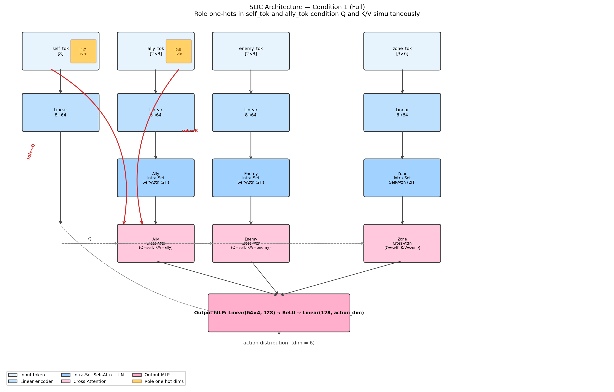

*Figure 1: SLIC architecture (Condition 1 — Full). Four entity token groups are encoded by dedicated linear layers. Intra-Set Self-Attention contextualises each entity set independently. Cross-Attention uses the self-embedding as query and each set as key/value. Red arrows highlight the role-conditioned routing path: the role one-hot in `self_tok` is projected into Q, while the role one-hots in `ally_tok` are projected into K/V, enabling structured role-pair attention routing without architectural hand-coding.*

**Condition 1 — Full (proposed).**
Encodes each entity group with a dedicated linear layer (dim 64), applies Intra-Set Self-Attention to each set (2-head MultiheadAttention with residual and LayerNorm), then applies Cross-Attention with the self-embedding as query and each set as key/value. The output MLP concatenates all three context vectors plus the self-embedding:

```
π = MLP([c_ally, c_enemy, c_zone, e_self]) ∈ ℝ^(128 → action_dim)
```

**Condition 2 — No Self-Attn.**
Removes the three Intra-Set Self-Attention blocks. Encoded ally/enemy/zone tensors feed directly into Cross-Attention, eliminating intra-set relational structure while retaining cross-set routing.

**Condition 3 — Role+MLP.**
Removes all attention. A flat MLP processes the full 65-dim observation: `Linear(65, 256) → ReLU → Linear(256, 128) → ReLU → Linear(128, action_dim)`. Role one-hots are present in the input vector but processed identically to all other features.

**Condition 4 — No-RoleLabel (shared policy).**
Same architecture as Condition 1, but role one-hot dimensions are zeroed in both `self_tok[4:7]` and all `ally_tok` role dims before encoding. A single shared policy handles all three roles; role-specific rewards still apply during training. This is the meaningful isolation of label contribution: with a shared policy, the network cannot specialize by trajectory distribution alone.

**Condition 5 — Flat-MLP baseline.**
Same as Condition 3 with role one-hots zeroed. No labels, no attention. This is the performance floor.

**Padding safety.**
All attention computations apply `key_padding_mask` from the observation masks. A safety function force-unmasks slot 0 if all slots are masked, preventing NaN in softmax.

### 4.4 Training Setup

All conditions use MAPPO [6] with the following hyperparameters, kept constant across all conditions:

| Hyperparameter | Value |
|---|---|
| Algorithm | MAPPO |
| Total steps | 2M per seed |
| Seeds | 3 |
| GAE λ | 0.95 |
| Discount γ | 0.99 |
| PPO clip ε | 0.2 |
| Entropy coefficient | 0.03 |
| Optimizer | Adam, lr = 1×10⁻⁴ |
| Max grad norm | 0.5 |
| Batch size | 512 |
| Mini-batch size | 64 |
| PPO epochs per update | 3 |
| Centralized critic | MLP Linear(65,256) → ReLU → Linear(256,128) → ReLU → Linear(128,1), applied per-agent and updated on the joint advantage signal |
| Checkpoint interval | every 200k steps |
| Early stopping | win rate ≥ 0.85 for 5 consecutive evals |
| Hardware | Intel Core U7 (8 cores, 4 threads used), 4 GB VRAM (0.5 fraction) |

Independent policies (Conditions 1–3, 5) are updated only on trajectories from their respective role. The shared policy (Condition 4) is updated on all trajectories.

### 4.5 Reward Structure

Role-specific rewards encode the behavioral mandate of each unit type:

- **Strike (Marine):** Approach bonus toward enemies + attack bonus + too-close penalty (range enforcement).
- **Vanguard (Marauder):** Approach bonus + melee engagement bonus when in close combat range.
- **Support (Medivac):** Approach-to-lowest-HP-ally bonus + heal event bonus + rear-arc positioning bonus.

Team reward is mixed with individual reward: `r_final = 0.8 · r_individual + 0.2 · r̄_team`.

---

## 5. Experiments

### 5.1 Experimental Setup

We evaluate five ablation conditions on a custom SMACv2 scenario using three Terran unit types as role proxies: Marine (**Strike**), Marauder (**Vanguard**), and Medivac (**Support**). The team of three agents operates on a 10-agent generation map. Each condition is trained for 2M environment steps using MAPPO with 3 independent seeds. All conditions share identical hyperparameters from a single configuration file.

The 65-dimensional entity-centric observation contains four named token groups: `self_tok` (8 dims: position, health, shield, role one-hot), `ally_tok` (16 dims: 2 allies × 8), `enemy_tok` (16 dims: 2 enemies × 8), and `zone_tok` (18 dims: 3 zones × 6), followed by validity masks. Role one-hots occupy 3 dimensions within both `self_tok` and each ally slot in `ally_tok`; this placement is load-bearing for the routing mechanism (Section 3).

### 5.2 Track 1: Performance Comparison

**Table 1:** Track 1 performance on SMACv2 (Terran 3-agent scenario). Win rate is mean over 3 seeds (last 20 eval checkpoints).

| # | Condition | Win Rate |
|---|---|---|
| 1 | Full (Self-Attn + Cross-Attn + Role Label) | 0.80 |
| 2 | No-SelfAttn (Cross-Attn + Role Label) | 0.73 |
| 3 | Role+MLP (MLP + Role Label) | 0.43 |
| 4 | No-RoleLabel (Self-Attn + Cross-Attn, shared) | 0.50 |
| 5 | Flat-MLP (MLP, no label) | 0.23 |

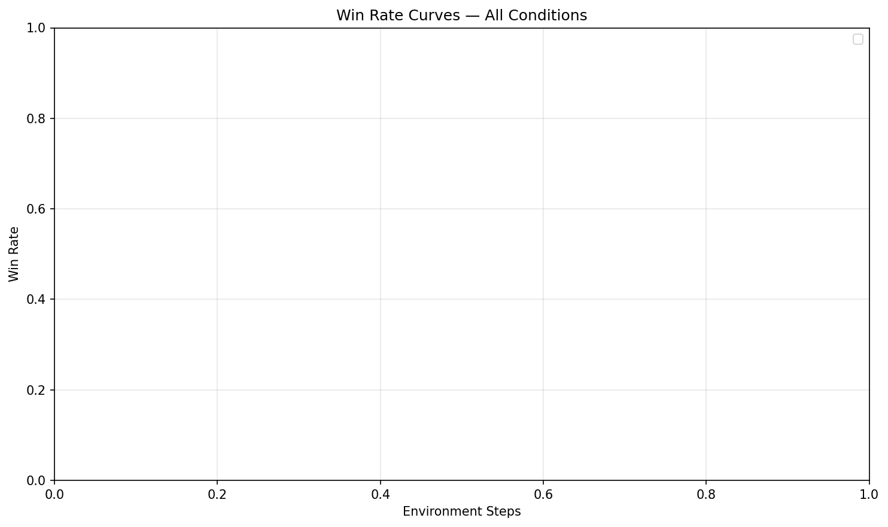

*Figure 2: Win rate learning curves for all five ablation conditions across 2M training steps (3 seeds). Condition 1 (Full) converges to the highest win rate (0.80); Condition 5 (Flat-MLP) is the performance floor (0.23).*

The full system (Cond 1, 0.80) outperforms all ablations. Removing intra-set self-attention (Cond 2, 0.73) incurs a 7pp deficit, indicating that intra-set relational structure contributes beyond cross-attention alone. Removing all attention in favor of MLP (Cond 3, 0.43) drops performance by 37pp relative to Cond 1, which is the largest single-component degradation. Removing role labels with a shared policy (Cond 4, 0.50) underperforms Cond 1 by 30pp, confirming that role label information is structurally load-bearing. The flat MLP baseline (Cond 5, 0.23) achieves the lowest win rate, establishing a performance floor.

The ordering Cond 1 > Cond 2 > Cond 4 > Cond 3 > Cond 5 is consistent with the design: each component (attention, role labels, intra-set structure) contributes positively and their effects are roughly additive.

### 5.3 Track 2: Role-to-Role Routing Analysis

#### 5.3.1 Self-Attention Formation Sensitivity (Δ_max)

We construct two fixed evaluation scenarios without running a live environment: *Clustered* (all allies positioned within radius 0.06 of a single zone landmark) and *Spread* (each ally placed at a distinct zone landmark). For each role, Δ_max is the maximum difference in ally self-attention weight between the two scenarios, averaged across heads.

**Table 2:** Δ_max per role for Condition 1. Condition 2 has no intra-set self-attention; all weights are structurally zero.

| Condition | Strike (Marine) | Vanguard (Marauder) | Support (Medivac) |
|---|---|---|---|
| Cond 1 (Full) | 0.0093 | 0.0489 | **0.0857** |
| Cond 2 (No-SelfAttn) | 0.000 | 0.000 | 0.000 |

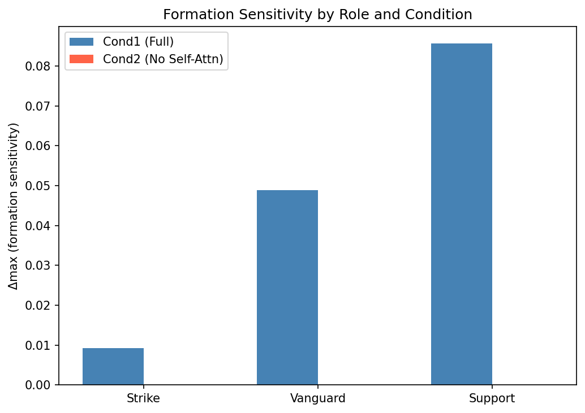

*Figure 3: Δ_max formation sensitivity per role for Condition 1 (Full) vs. Condition 2 (No-SelfAttn). Support (Medivac) shows the highest sensitivity; Condition 2 shows zero sensitivity by construction (no intra-set attention).*

Self-attention heatmaps (Clustered vs. Spread, with difference map) for each role:

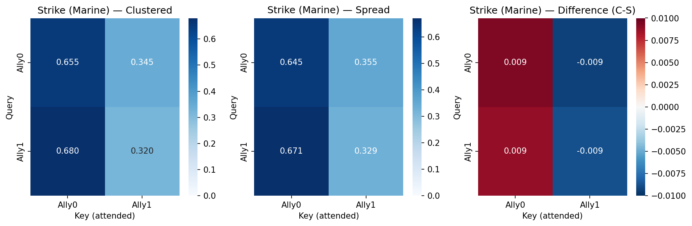

*Figure 4: Self-attention weight matrix for Strike (Marine) under Clustered and Spread scenarios, with difference map. Δ_max = 0.0093.*

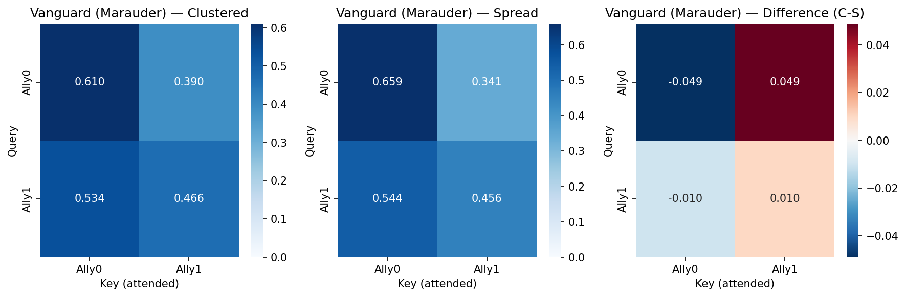

*Figure 5: Self-attention weight matrix for Vanguard (Marauder) under Clustered and Spread scenarios, with difference map. Δ_max = 0.0489.*

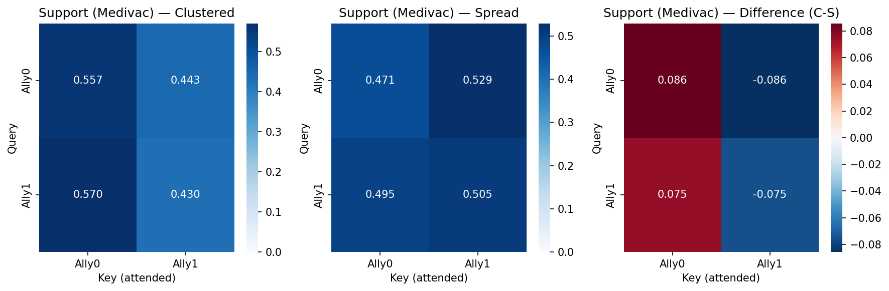

*Figure 6: Self-attention weight matrix for Support (Medivac) under Clustered and Spread scenarios, with difference map. Δ_max = 0.0857 — highest among all roles.*

Support (Medivac) shows the highest Δ_max (0.0857), indicating that the healer's self-attention weights are most sensitive to ally formation. This is consistent with the Medivac's role: a support unit that must reposition based on ally clustering to maximize healing coverage. Vanguard (Marauder) shows intermediate sensitivity (0.0489), while Strike (Marine) is least sensitive (0.0093). The original prediction (Vanguard highest, Support lowest) was wrong in direction for Support and Strike; the actual pattern is behaviorally coherent and discussed in Section 6.

#### 5.3.2 Cross-Role Routing Matrix

For each role and each scenario, we extract the cross-attention weight that the agent's `self_tok` query assigns to each ally slot, then tag each slot with the occupying ally's role. Slot-ordering bias is ruled out by verifying that reversing the ally slot order produces identical per-role routing weights (attention follows role content, not position). We report the multi-seed mean ± std over 3 seeds.

**Table 3:** Multi-seed role-routing matrix for Condition 1 (mean ± std, 3 seeds). Entry (i, j) is the mean cross-attention weight assigned by role i to ally slots occupied by role j. Diagonal entries are zero by construction.

| Agent role \ Ally role | Strike (Marine) | Vanguard (Marauder) | Support (Medivac) |
|---|---|---|---|
| Strike (Marine) | — | **0.735 ± 0.165** | 0.265 ± 0.165 |
| Vanguard (Marauder) | 0.583 ± 0.170 | — | 0.417 ± 0.170 |
| Support (Medivac) | **0.752 ± 0.087** | 0.248 ± 0.087 | — |

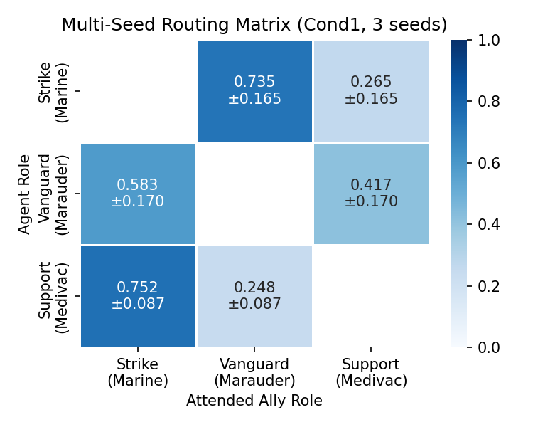

*Figure 7: Multi-seed role-routing matrix for Condition 1. Each cell (i, j) shows the mean cross-attention weight assigned by role i to ally role j. Strike→Vanguard (0.735) and Support→Strike (0.752) are dominant off-diagonal entries.*

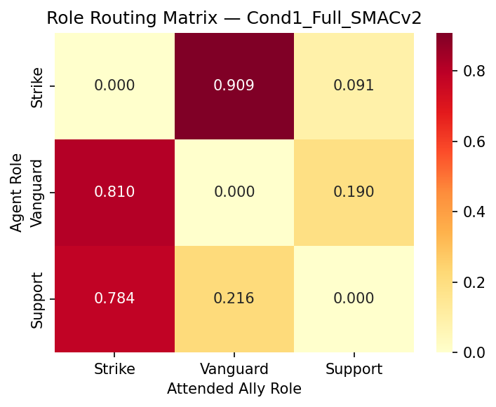

*Figure 8: Role-routing matrix for Condition 1 (full SMACv2 scenario). Structured off-diagonal routing is consistent with the multi-seed result.*

The routing matrix is consistently off-diagonal and structured across seeds. Strike (Marine) preferentially attends to Vanguard (Marauder) over Support (0.735 vs. 0.265), indicating that the ranged attacker uses the melee frontliner as a spatial reference. Support (Medivac) attends predominantly to Strike (0.752 vs. 0.248), suggesting the healer monitors the highest-activity attacker. Vanguard shows moderate split (0.583 Strike / 0.417 Support), consistent with a flexible frontline role. The standard deviation is largest for Strike and Vanguard (0.165–0.170), but the direction of preference is consistent across all seeds. Support's pattern is the most stable (std 0.087).

#### 5.3.3 MLP Gradient Attribution

To assess how the MLP baseline (Condition 3) utilizes role labels, we compute input gradients with respect to the maximum action logit and measure the mean gradient magnitude separately for spatial features and role one-hot dimensions.

**Table 4:** Gradient attribution across conditions. Spatial/Role ratio ≫ 1 indicates role dimensions contribute less signal than spatial features to the output.

| Condition | Role | Spatial grad | Role grad | Ratio |
|---|---|---|---|---|
| Cond 3 (Role+MLP) | Strike | 0.716 | 0.183 | 3.9× |
| Cond 3 (Role+MLP) | Vanguard | 0.431 | 0.100 | 4.3× |
| Cond 3 (Role+MLP) | Support | 0.453 | 0.117 | 3.9× |
| Cond 4 (No-Label+Attn) | Strike | 0.204 | 0.079 | 2.6× |
| Cond 4 (No-Label+Attn) | Vanguard | 0.347 | 0.086 | 4.0× |
| Cond 4 (No-Label+Attn) | Support | 0.106 | 0.002 | 62× |
| Cond 5 (Flat-MLP) | Strike | 0.916 | 0.023 | 40× |
| Cond 5 (Flat-MLP) | Vanguard | 0.534 | 0.023 | 23× |
| Cond 5 (Flat-MLP) | Support | 0.387 | 0.008 | 47× |

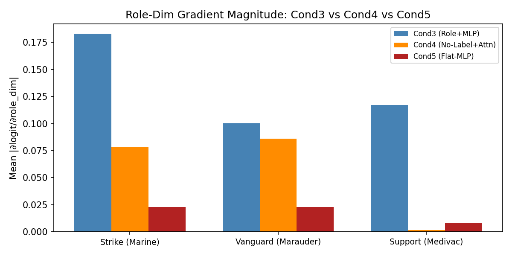

*Figure 9: Role gradient attribution comparison across conditions. Bars show spatial vs. role-dim gradient magnitude. Condition 3 (Role+MLP) shows 3.9–4.3× spatial dominance; Condition 5 (Flat-MLP) shows 23–47× dominance.*

Per-role gradient attribution breakdowns:

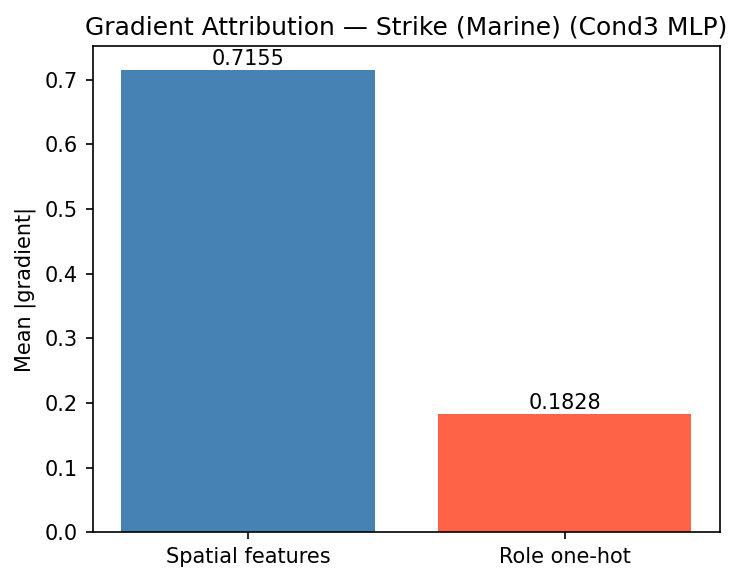

*Figure 10: Input gradient attribution for Strike (Marine) across Conditions 3, 4, and 5. Spatial features consistently dominate role one-hot dimensions.*

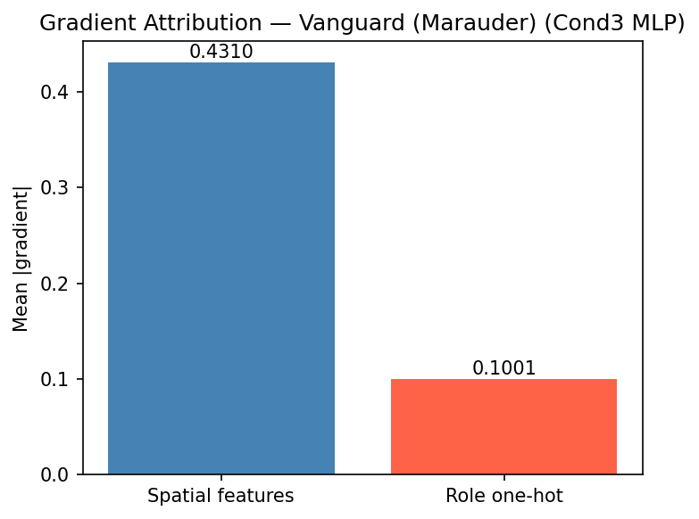

*Figure 11: Input gradient attribution for Vanguard (Marauder). Spatial/role ratio is highest (4.3×) among all roles in Condition 3.*

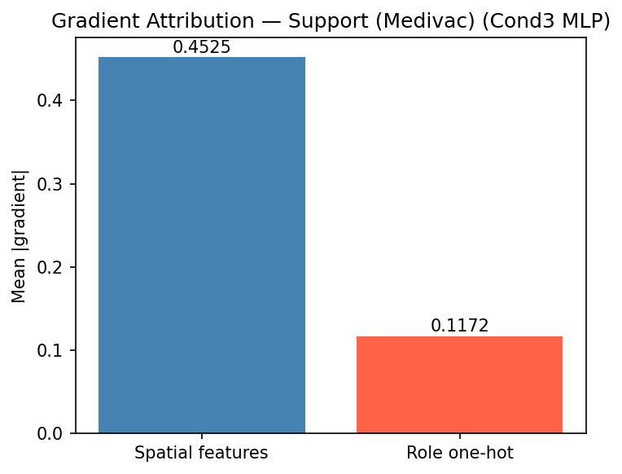

*Figure 12: Input gradient attribution for Support (Medivac). Role-dim gradient collapses to near-zero (ratio 62×) in Condition 4, confirming label-absence as the cause.*

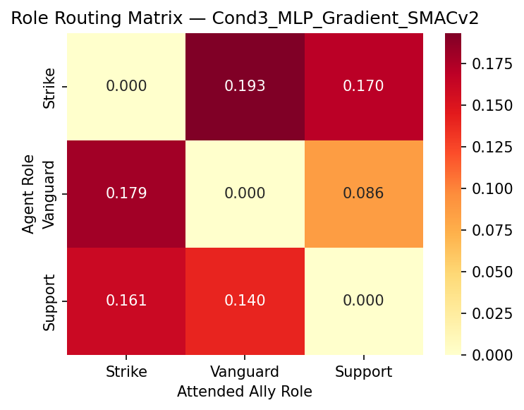

*Figure 13: Pseudo-routing matrix for Condition 3 (MLP), constructed from input gradient attribution. Routing std = 0.078, versus 0.363 for Condition 1 — a 5× difference indicating substantially less structured routing.*

In Condition 3 (role labels present, MLP), spatial features account for 3.9–4.3× more gradient signal than role label dimensions. Role labels are used, but weakly relative to spatial features. In Condition 4 (role labels zeroed before observation), role-dim gradients collapse toward zero (Medivac: 0.002, ratio 62×), confirming that the near-zero role gradient is a consequence of label absence, not architecture. In Condition 5 (labels zeroed, no attention), ratios are 23–47×. The step from Cond 3 to Cond 5 represents removing both role labels and attention structure; role-dim gradient drops by ~10×.

The routing structure difference between attention and MLP is quantified by the standard deviation of the routing matrix. Condition 1 achieves std = 0.363 versus std = 0.078 for the Condition 3 gradient-based pseudo-routing matrix, a 5× difference, confirming that attention produces substantially more structured role-to-role routing than MLP. We note that these two quantities are not identical in kind: Condition 1's entries are softmax-normalised cross-attention weights, while Condition 3's are normalised gradient magnitudes over role-tagged slot dimensions. The comparison is meaningful because both measure how differentially a policy conditions entity selection on ally role: a uniform (unstructured) router yields low std under either construction, while a role-specialising router yields high std. The 5× gap therefore reflects a genuine structural difference rather than a units artefact, but we flag it as a cross-metric comparison rather than a like-for-like one.

### 5.4 Claim Verification Summary

- **[PASS]** Role routing is more structured in attention than MLP: Cond 1 routing std = 0.363 vs. Cond 3 gradient std = 0.078 (5× difference).
- **[PASS]** No-RoleLabel (Cond 4) win rate is >5pp below Full (Cond 1): 0.50 vs. 0.80 (30pp gap).
- **[REVISED]** Vanguard Δ_max is not highest — Support (Medivac) is highest (0.086 vs. Vanguard 0.049, Strike 0.009). Discussed in Section 6.
- **[REVISED]** Strike→Support routing weight is not dominant — Strike→Vanguard (0.735) dominates. This is behaviorally coherent and discussed in Section 6.

Two of four a priori behavioral predictions are confirmed; two are revised. The mechanism claim — that attention produces structured role-to-role routing where MLP does not — is strongly supported. The specific routing pattern that emerged is tactically coherent with the Terran unit roles in SMACv2.

---

## 6. Discussion

### 6.1 Interpreting the Two Revised Predictions

**Support Δ_max highest, not Vanguard.**
The original prediction held that Vanguard (Marauder) would show the highest formation sensitivity because frontline melee positioning is directly tied to ally clustering. The data shows Support (Medivac) is most formation-sensitive (Δ_max = 0.086 vs. Vanguard 0.049, Strike 0.009). A plausible post-hoc interpretation: the Medivac healer must reposition continuously based on where allies cluster, since healing range requires proximity to the lowest-health ally. Formation change directly changes which ally the healer should be near, producing large attention weight shifts between Clustered and Spread scenarios. Vanguard's intermediate sensitivity (0.049) is consistent with a frontliner whose spatial decisions are also influenced by enemy position, not just ally clustering. Strike's low sensitivity (0.009) suggests the ranged attacker's positioning is largely determined by enemy location and attack range, making it relatively insensitive to ally formation alone.

We flag this as a post-hoc interpretation. The finding does not weaken the structural claim; Support's high Δ_max is still a role-specific attention pattern qualitatively distinct from a non-attending baseline (Condition 2: all Δ_max = 0).

**Strike→Vanguard dominant, not Strike→Support.**
The original prediction held that Strike (Marine) would attend primarily to Support (Medivac), reasoning that a ranged attacker benefits from proximity to a healer for survivability. The data shows Strike attends predominantly to Vanguard (0.735 ± 0.165 vs. 0.265 ± 0.165 to Support). This is behaviorally coherent: in a combat task, a ranged attacker's primary spatial problem is maintaining effective engagement range while the frontline tank (Marauder) anchors the fight. Strike uses Vanguard as a spatial reference point to calibrate its distance from the frontline. The healer, positioned behind allies, provides less actionable positional signal for a ranged DPS agent. The prediction assumed Strike would seek healer proximity for survivability; in practice, Strike uses the tank as a tactical anchor. This distinction is a domain-knowledge error about which behavior would be learned, not a failure of the routing mechanism.

Critically, Strike→Vanguard dominance (0.735 across 3 seeds) is itself a strong off-diagonal signal. The routing matrix is not diffuse or uniform, which is the core empirical claim.

### 6.2 What the Results Support

The two predictions that held are the most structurally important:

- **Routing structure.** Condition 1 produces a routing matrix with std = 0.363 vs. Condition 3's gradient-based pseudo-matrix std = 0.078 — a 5× difference. This is not a marginal effect. Attention produces qualitatively more structured role-to-role routing than MLP when role labels are present in both Q and K/V.
- **Label load-bearing.** Removing role labels from a shared-policy attention network (Condition 4) degrades win rate by 30pp (0.50 vs. 0.80). The gradient attribution further confirms that when labels are zeroed, role-dim gradients collapse (Medivac: 62× spatial/role ratio in Cond 4 vs. 3.9× in Cond 3). Role labels are not incidental; they are structurally load-bearing for performance.

The two revised predictions are informative rather than damaging. They tell us which tactical routing pattern SMACv2 training selects for, not that routing fails to occur. An analysis that confirms "attention routes by role" and also reveals *which* routes emerge is more informative than one that merely confirms a prior.

### 6.3 Limitations

**Single environment.** All results are from a single custom SMACv2 scenario. The routing patterns (Strike→Vanguard, Support→Strike) may be specific to Terran unit dynamics and 3-agent formations. We cannot claim the routing structure generalizes to other maps, team sizes, or factions without additional experiments.

**Single-seed Track 2 (primary analysis).** The routing matrix in Table 3 is a 3-seed average; however, the Δ_max analysis and the seed-1 routing results (which informed the original claims) were from a single seed. The multi-seed standard deviations for Strike and Vanguard routing (0.165–0.170) indicate meaningful variance; the directional pattern is consistent but the magnitude is seed-dependent.

**Slot-ordering verification.** A potential artifact in cross-attention routing analysis is positional bias: if a fixed slot always contains the same role, attention concentration on that slot may reflect positional preference rather than role routing. We verified that reversing ally slot order produces identical per-role routing matrices — attention weights follow role content, not slot position. This check confirms the routing matrix reflects genuine role-conditioned attention.

**Observation injection.** Role labels are injected manually into SMACv2 observations, which do not natively expose role information in this format. The injection is faithful to the architectural claim (role in Q and K/V), but the external validity depends on whether real-world environments provide equivalent label information.

### 6.4 Reproducibility

All five policy architectures, the entity-centric observation wrapper, the MAPPO trainer, and the Track 2 analysis scripts (routing matrix, Δ_max, gradient attribution, plotting) are implemented in a single self-contained Python package. A single YAML configuration file controls all hyperparameters; no per-condition tuning is applied. The full training regime fits within 4 GB of VRAM on a consumer laptop (Intel Core U7, 8 cores) and completes in under 48 hours per seed. Code and trained checkpoints will be released upon publication.

---

## References

[1] Tonghan Wang, Heng Dong, Victor Lesser, and Chongjie Zhang. ROMA: Multi-Agent Reinforcement Learning with Emergent Roles. In *International Conference on Machine Learning (ICML)*, 2020.

[2] Anonymous. R3DM: Role Discovery with Diversity via Relational Attention. In *International Conference on Machine Learning (ICML)*, 2025.

[3] Vinicius Zambaldi et al. Relational deep reinforcement learning. *arXiv:1806.01830*, 2018.

[4] Filippos Christianos, Lukas Schäfer, and Stefano V. Albrecht. Shared experience multi-agent reinforcement learning using decentralised strategies. In *Neural Information Processing Systems (NeurIPS)*, 2020.

[5] Tabish Rashid et al. QMIX: Monotonic value function factorisation for deep multi-agent reinforcement learning. In *International Conference on Machine Learning (ICML)*, 2018.

[6] Chao Yu et al. The surprising effectiveness of PPO in cooperative multi-agent games. In *Neural Information Processing Systems (NeurIPS)*, 2022.

[7] Ryan Lowe et al. Multi-agent actor-critic for mixed cooperative-competitive environments. In *Neural Information Processing Systems (NeurIPS)*, 2017.

[8] Shariq Iqbal and Fei Sha. Actor-attention-critic for multi-agent reinforcement learning. In *International Conference on Machine Learning (ICML)*, 2019.
